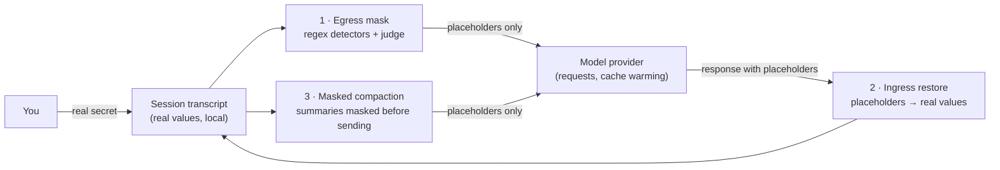
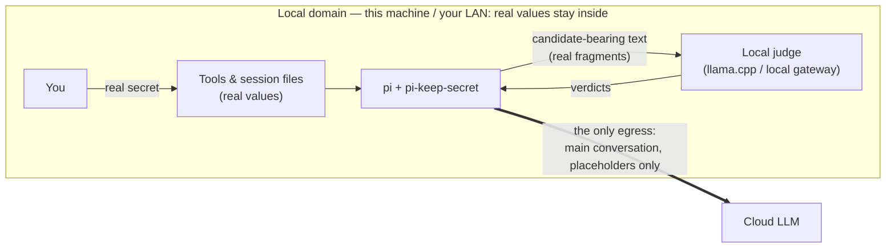

# pi-keep-secret

[](https://github.com/jesset/pi-keep-secret/actions/workflows/ci.yml)
[](https://www.npmjs.com/package/pi-keep-secret)
[](LICENSE)

**Model providers see only placeholders. Your tools and transcript keep the real values.**

pi-keep-secret is an open-source extension for [pi](https://github.com/earendil-works/pi) coding-agent sessions that masks secrets in **every outbound model request** — deterministically, reversibly, and transparently to your local workflow.

## What & Why

You paste an API key, a tool reads a token out of a config file, a log line leaks a password — and all of it flows into the context window of a remote model. pi-keep-secret runs inside the pi process and rewrites that text before it leaves your machine:

- **Egress masking** — every outbound model request (main chat turns, cache warming, compaction summaries, branch summaries) has credentials replaced by format-preserving deterministic placeholders: `sk-live-abc…` becomes `sk-<hash>`. Same secret, same placeholder, every time.
- **Ingress restoration** — when the model responds (or emits tool calls) with placeholders, they are restored to real values before the transcript is written and before any tool executes. Your tools, files, and session history always see the real thing.
- **Masked compaction** — pi's built-in compaction is replaced by a masked variant, so the summarization model also only ever sees placeholders.



Detection runs in two layers: a fast, configurable regex detector set for known credential shapes (OpenAI keys, GitHub PATs, AWS access keys, Google API keys, Slack bot tokens, PEM private keys, JWTs), and an optional [System One judge](#judge-setup) — a classifier model that catches low-entropy secrets no regex can see. Judge failures fail closed: unverified candidates are masked, never released.

## Recommended topology

The deployment shape this extension is designed around: **run the decision model on infrastructure you control — your machine or your LAN — so secrets never leave the local domain.** Judge calls carry candidate strings, and those candidates are real secret fragments (judging needs the original text). With a local judge, that traffic stays inside the local domain; the only outbound flow left is the main conversation, which carries placeholders only. Real values then live in exactly two places: local processes (pi and the local judge) and local disk (session files). The [threat model](docs/threat-model.md#trust-boundaries)'s "judge provider must be trusted" trade-off becomes a structural guarantee.



| Judge placement | Judge traffic (candidate-bearing text) | Main conversation traffic |
|---|---|---|
| Cloud | Leaves your machine — the judge provider must sit inside your main provider's trust boundary | Placeholders only |
| **Local (recommended)** | Never leaves the local domain — a closed loop on your machine / LAN | Placeholders only — the only egress left |

How to get there — the three local-judge channels (llama.cpp natively, a local LiteLLM gateway, or any LAN endpoint speaking System One / OpenAI Decisions) — is covered in [Local judge deployment](#local-judge-deployment).

## Quickstart

**1. Install.** pi-keep-secret is published on npm and installs as a [pi package](https://github.com/earendil-works/pi/blob/main/packages/coding-agent/docs/packages.md):

```bash
pi install npm:pi-keep-secret
```

This records the package in your user-level pi settings (`~/.pi/agent/settings.json`) and loads it in every pi session. `pi list` shows it, `pi update --extensions` updates it, `pi remove npm:pi-keep-secret` removes it.

Prefer not to install from npm (offline machine, vendoring, or you cloned the repo)? Copy the extension into your user-level extensions directory instead — same effect:

```bash
git clone https://github.com/jesset/pi-keep-secret
mkdir -p ~/.pi/agent/extensions/pi-keep-secret
cp -R pi-keep-secret/{package.json,extension,src} ~/.pi/agent/extensions/pi-keep-secret/
```

Other shapes: `pi -e npm:pi-keep-secret` tries it for one invocation; `pi --extension /path/to/pi-keep-secret "…"` loads a checkout for one session; `<project>/.pi/extensions/pi-keep-secret/` scopes it to one project.

**2. Verify.** Start pi and run:

```
/keep-secret test
```

The self-test sends synthetic samples (a fake `sk-` key, a key hidden in a URL, a fake password, a clean order number) through the session's live masking chain and reports masked / not-masked versus expectation. With no config file, the regex layer alone already masks the `sk-` samples — everything passing shows `info`.

**3. (Optional) Configure.** Without a config file you get the built-in detector set and regex-only masking. To add your own detectors, drop a `config.json` at `~/.pi/agent/extensions/pi-keep-secret/config.json` (or point `PI_KEEP_SECRET_CONFIG` anywhere):

```json
{
  "detectors": [
    { "name": "corp-api-key", "pattern": "corp-[A-Za-z0-9]{20,}", "redactTemplate": "corp-{hash}" }
  ],
  "detectorsMode": "merge"
}
```

`/keep-secret reload` hot-applies detector changes without restarting the session.

## How it works

Three moving parts, one shared registry:

1. **Message traversal + detectors.** On every outbound request (`context_with_system`), the extension walks the full message tree — user text, tool results, assistant history (text, thinking, tool-call arguments), system prompt sections, shell-command output, compaction and branch summaries — and runs each text leaf through the detector chain: the judge first (when configured; it needs the original text), then the regex pipeline (which idempotently skips already-issued placeholders). Images and signature fields pass through byte-identical.
2. **Deterministic placeholders + registry.** Each detected secret is issued a placeholder from a session-scoped registry: a hash of the secret rendered into the detector's template (`sk-<hash>`, `ghp_<hash>`, …), so the shape survives and the same secret always maps to the same placeholder. One secret keeps exactly one placeholder form for the whole session, whichever layer detected it.
3. **Ingress restoration.** On the way back (`message_end`, `tool_call`), placeholders are restored to real values before the transcript is persisted and before tools execute. A truncated half-placeholder (from `max_tokens` cuts) still restores.

Compaction is covered too: `/compact`, threshold compaction, overflow, and branch summaries all run through the masked pipeline (one sentence version: **if it leaves for a model, it is masked**). The full analysis of what is and is not protected lives in the [threat model](docs/threat-model.md).

## Threat model & limitations

**What it protects:** every outbound model request from the session — the main chat chain, cache warming, compaction summaries, branch summaries. Provider-side, requests and logs contain placeholders only. Judge and regex layers chain (judge first, regex after); judge errors and a missing classifier model fail closed by default — unverified candidates are masked, never released.

**What it does not protect:**

- **Local session files keep real values — by design.** The transcript on your disk holds real secrets; local-disk protection is a separate concern. If your threat model includes someone reading `~/.pi`, this extension does not help there.
- **Streaming briefly shows placeholders.** While a response streams, the terminal can display placeholder text for a moment; it is restored to real values when the message completes.
- **A forced `before_agent_start` system prompt bypasses masking.** Another extension that force-injects a system prompt containing secrets bypasses the masking hook (pi-keep-secret itself forces no prompt).
- **`judge.onMissing: "regex_only"` leaves a gap.** If you configure the judge and its classifier model is missing, the default is fail-closed (mask unverified candidates). The explicit `regex_only` option degrades to the regex layer only — in that mode, low-entropy secrets no regex can see still egress, visibly and by your informed choice.

The complete framework — assets, adversaries, coverage, trust boundaries — is in [docs/threat-model.md](docs/threat-model.md).

## Configuration reference

One JSON file, unknown keys rejected, all-or-nothing validation (any invalid value falls back to the built-in defaults **and** surfaces the errors). Path resolution: `PI_KEEP_SECRET_CONFIG` environment variable → `~/.pi/agent/extensions/pi-keep-secret/config.json` (this default location is fixed and works regardless of how you installed the extension itself).

```json
{
  "detectors": [
    { "name": "corp-api-key", "pattern": "corp-[A-Za-z0-9]{20,}", "redactTemplate": "corp-{hash}" }
  ],
  "detectorsMode": "merge",
  "hashLength": 12,
  "cleanCache": { "limit": 20000, "ttlMs": 86400000 },
  "judge": {
    "provider": "litellm",
    "modelId": "typesafe/jev-latest",
    "api": "systemone",
    "gateThreshold": 0.5,
    "candidateThreshold": 0.7,
    "redactTemplate": "key-{hash}",
    "onMissing": "fail_closed"
  }
}
```

| Key | Type | Default | Meaning |
|---|---|---|---|
| `detectors` | array | — | Custom regex detectors: `name`, `pattern`, `redactTemplate` (default `{hash}`; may appear multiple times to preserve shape, e.g. `"eyJ{hash}.{hash}.{hash}"` for JWTs). Empty list is rejected (it would silently disable all detection). |
| `detectorsMode` | `"replace" \| "merge"` | `"replace"` | `replace`: your `detectors` wholly replace the built-ins. `merge`: built-ins + yours, same-name entries overriding the built-in in place (tune a pattern or template), new names appended. |
| `hashLength` | int 1–52 | `12` | Length of the placeholder hash segment (base32 of SHA-256). |
| `cleanCache` | object | `20000` / 24h | `{ limit, ttlMs }` tuning for the clean-text cache that keeps per-round cost proportional to *new* messages. |
| `judge` | object | — | The [judge](#judge-setup) section; absent means regex-only. See below for all keys. |

Built-in detectors: `openai-key` (`sk-…`, excluding `sk-ant-`), `github-pat` (`ghp_…`), `aws-access-key-id` (`AKIA…`), `google-api-key` (`AIza…`), `slack-bot-token` (`xoxb-…`), `pem-private-key` (multi-line PEM blocks), `jwt` (three base64url segments).

Invalid config → built-in defaults + visible errors (TUI notification, `/keep-secret` status). Detector-set changes hot-apply via `/keep-secret reload`; `hashLength`, `cleanCache`, and `judge` changes take effect in new sessions.

## Judge setup

The judge layer catches secrets that regexes cannot (a pasted password, a low-entropy token). It needs a **classifier model** registered in pi's model registry (`models.json` or an extension's `pi.registerProvider`), speaking one of two wire protocols:

- `"api": "typesafe-system-one"` — pi-ai's System One transport (POST `<baseUrl>/systemone`)
- `"api": "openai-decisions"` — pi-ai's OpenAI Decisions transport (POST `<baseUrl>/decisions`)

Any local llama.cpp model doubles as a classifier too (`llama-cpp-classify`) — see [Local judge deployment](#local-judge-deployment) below.

A LiteLLM gateway serves both routes from the same backend; set the provider's `baseUrl` to `https://<host>/v1` (the transport appends the path). Example `models.json`:

```json
{
  "providers": {
    "litellm": {
      "baseUrl": "https://gateway.example.com/v1",
      "apiKey": "$LITELLM_API_KEY",
      "models": [
        {
          "type": "classifier",
          "id": "typesafe/jev-latest",
          "name": "Jev (System One)",
          "api": "typesafe-system-one",
          "input": ["text"],
          "contextWindow": 128000
        }
      ]
    }
  }
}
```

Then point the `judge` section at it:

```json
{
  "judge": {
    "provider": "litellm",
    "modelId": "typesafe/jev-latest",
    "onMissing": "fail_closed"
  }
}
```

Full `judge` keys: `provider`, `modelId` (required, the classifier reference), `api` (`"systemone" | "decisions"` — a **wire preference**; absent follows the registered model's `api`; with a built-in classifier api it overrides the dispatch wire, with a plugin-custom api the plugin's choice wins and the preference is reported ineffective), `gateThreshold` (0.5), `candidateThreshold` (0.7), `batchSize` (128), `maxBatches` (8), `maxChars` (24000), `minCandidateLength` (6), `concurrency` (8), `redactTemplate` (`key-{hash}`), `onMissing` (`fail_closed` default | `regex_only` explicit informed degradation).

How it judges: a single gate question ("does a complete credential exist in this text?") short-circuits clean texts; on a gate hit, each extracted candidate gets its own boolean question in batches. Classify errors, missing answers, and candidates beyond the batch guardrail are all masked as unverified — a down judge never means an unmasked request.

### Local judge deployment

The [recommended topology](#recommended-topology): keep judge traffic — the candidate-bearing text — inside the local domain. Three channels:

**llama.cpp (native pi support).** Start the router (`llama serve`; keep it on `127.0.0.1` or bind it to a LAN address), then `/login llama.cpp` in pi and load a chat model with `/llama` (see pi's [llama.cpp guide](https://github.com/earendil-works/pi/blob/main/packages/coding-agent/docs/llama-cpp.md)). pi's llama.cpp provider lists every chat model as a classifier as well, under the `llama-cpp-classify` API: the model never generates an answer — each question becomes one chat prompt, and the answer is read from the next-token probabilities of its `Yes`/`No` labels. (Native decision models such as Jev are listed too, via llama.cpp's System One endpoint.) No `models.json` entry is needed — reference the loaded model directly; `modelId` is the id shown by `/model`:

```json
{
  "judge": {
    "provider": "llama.cpp",
    "modelId": "qwen3-4b",
    "onMissing": "fail_closed"
  }
}
```

Threshold tuning applies to this channel: chat-model label probabilities are calibrated differently from trained decision models (raw label probabilities tend to be overconfident), so the `gateThreshold` (0.5) / `candidateThreshold` (0.7) defaults may need adjusting per model — `/keep-secret test` shows the effect. Leave `judge.api` unset here: it chooses between the System One and Decisions wires and has no llama.cpp meaning.

**Local / LAN LiteLLM gateway.** The same registration as above, with the provider's `baseUrl` pointing at your own gateway instead of a cloud host:

```json
{
  "providers": {
    "litellm": {
      "baseUrl": "http://localhost:4000/v1",
      "apiKey": "$LITELLM_API_KEY"
    }
  }
}
```

Both routes (`/v1/systemone`, `/v1/decisions`) come from the same backend and the `judge.api` wire preference applies unchanged — no config semantics differ from the cloud setup.

**Any LAN endpoint speaking System One or OpenAI Decisions.** A self-hosted service implementing either protocol is a judge endpoint like any other: register a classifier model pointing at it (`"api": "typesafe-system-one"` or `"openai-decisions"`), then reference it from the `judge` section.

## How it behaves

- **The model may notice.** A provider sees consistent placeholders where a secret was; models sometimes comment on the masking layer. That carries no leak — the provider never sees the real value.
- **The "restoration illusion" is transparency by design.** When the assistant appears to quote your real key back at you, the model actually emitted a placeholder; the ingress restoration layer turned it into the real value before it reached your terminal and tools. Your transcript and tool executions hold real values; the wire holds placeholders.
- **One secret, one form.** Whichever layer detects it and whichever template suggested a shape, a given secret leaves the session in exactly one placeholder form for the whole session, so the model never sees "the same key as two different values" in one request.
- **Layering with other extensions.** Tool-approval style extensions operate on the restored (real-value) layer — the correct complementary position. If placeholder salience matters in your environment, shape templates (`judge.redactTemplate`, detector `redactTemplate`) close to your real key formats.

## Commands

- `/keep-secret` — status: detector config (source, mode, names), registry and cache stats, per-detector hit counts, judge counters and effective wire, compaction cancellation count.
- `/keep-secret test` — the self-test described in [Quickstart](#quickstart).
- `/keep-secret reload` — re-read the config file; detector changes hot-apply.

Uninstalling is just removing the package: `pi remove npm:pi-keep-secret` (or delete `~/.pi/agent/extensions/pi-keep-secret/` for the copy install). There is no other on-disk state — the registry and caches are in-process and die with the session.

## FAQ

**What is the performance overhead?**
A clean-text cache short-circuits re-scanning: each round only newly added messages are actually scanned, so steady-state cost grows with the conversation delta, not its length. Texts that contained a secret are never cached-clean and are re-scanned every round (that is the safety property). The judge adds one gate question per text leaf, batched candidate questions only on gate hits, chunked at 24 000 chars with an 8-batch guardrail against pathological blocks.

**Which models and providers are supported?**
The masking itself is provider-agnostic — it runs inside the pi process before any request, so every provider pi supports is covered. The judge layer specifically needs a classifier model speaking System One or OpenAI Decisions (e.g. behind a LiteLLM gateway's `/v1/systemone` or `/v1/decisions`) — or, locally, any chat model served by llama.cpp, which pi lists as a `llama-cpp-classify` classifier; see [Local judge deployment](#local-judge-deployment).

**Does the judge see my secrets?**
The judge's gate and candidate questions carry the candidate-bearing text — real secret fragments, because judging needs the original; that is the whole reason the judge endpoint belongs inside your trust boundary. Run it locally (llama.cpp on this machine, or a LAN gateway / endpoint) and those calls never leave the local domain — the [recommended topology](#recommended-topology). Either way the judge only returns verdicts: it stores nothing, and what is kept locally (transcript, tools, registry) is unchanged.

**Where are my secrets stored?**
Nowhere new. Real values live where they already lived (your files, your transcript); the placeholder mapping and caches are in-process, session-scoped, and vanish when the session ends. No telemetry, no external calls except the model requests you already make — plus judge questions if you configure the judge.

**How do I turn it off completely?**
Remove the extension (`pi remove npm:pi-keep-secret`, or delete the extensions directory). There is deliberately no config switch that disables masking — an empty `detectors` list is a rejected config error.

**Does this stack with gateway-side masking?**
Yes, and it is complementary: gateway layers inspect traffic that has already left your machine; pi-keep-secret masks at the source, before any request is built. A gateway in front sees placeholders (or nothing left to catch).

**Can secrets leak at all?**
Within scope — outbound model requests — no path ships real values, including failures (judge down ⇒ fail closed; compaction summarizer failing ⇒ compaction cancelled, never an unmasked fallback). Outside that scope, see [Threat model & limitations](#threat-model--limitations): local transcripts keep real values by design, streaming shows placeholders briefly, forced system prompts from other extensions bypass the hook, and an explicit `regex_only` degradation is the one informed gap.

## Security

Found a security issue? Please use [GitHub's private vulnerability reporting](https://github.com/jesset/pi-keep-secret/security/advisories/new) — details and expectations in [SECURITY.md](SECURITY.md).

## Contributing

Issues drive the work; PRs welcome. See [CONTRIBUTING.md](CONTRIBUTING.md) for setup (bun install, tests, typecheck) and conventions. Deep design notes live in [docs/dev-notes.md](docs/dev-notes.md).

## License

[MIT](LICENSE)
