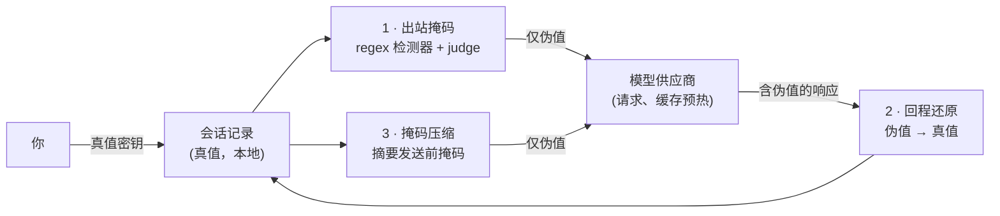
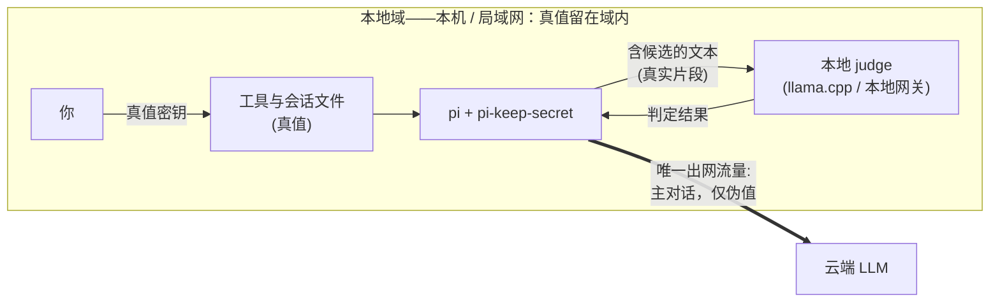

# pi-keep-secret

[](https://github.com/jesset/pi-keep-secret/actions/workflows/ci.yml)
[](https://www.npmjs.com/package/pi-keep-secret)
[](LICENSE)

**模型供应商只看到伪值。你的工具与会话记录保留真值。**

pi-keep-secret 是 [pi](https://github.com/earendil-works/pi) 编码代理会话的开源扩展，对**一切出站模型请求**中的密钥做掩码——确定性、可逆、对本地工作流完全透明。

## 是什么，为什么

你粘贴了一个 API key，工具从配置文件里读出了 token，日志行带出了密码——这些都会流入远端模型的上下文窗口。pi-keep-secret 运行在 pi 进程内，在文本离开你的机器之前完成改写：

- **出站掩码**——一切出站模型请求（主对话轮次、缓存预热、压缩摘要、分支摘要）中的凭据被替换为格式保持的确定性伪值：`sk-live-abc…` 变成 `sk-<hash>`。同一密钥恒同伪值。
- **回程还原**——模型响应（或发起工具调用）中的伪值，在会话记录落盘之前、任何工具执行之前被还原为真值。你的工具、文件与会话历史始终看到真值。
- **掩码压缩**——pi 自带的压缩被掩码版本整体替换，摘要模型也只看到伪值。



检测分两层：一层是快速、可配置的 regex 检测器集，覆盖已知凭据形态（OpenAI key、GitHub PAT、AWS 访问 key、Google API key、Slack bot token、PEM 私钥、JWT）；另一层是可选的 [System One judge](#judge-配置)——一个分类器模型，能抓到 regex 看不见的低熵密钥。judge 故障时 fail closed：未验证候选一律掩码，绝不放行。

## 推荐拓扑

本扩展围绕的典型部署形态：**决策模型运行在你掌控的基础设施上——本机或局域网——secret 因此不离开本地域。** judge 调用携带候选串，而候选串是真实的 secret 片段（判定需要原文）。judge 本地部署后，这类流量全程留在本地域内；剩下的唯一出站流量是主对话——且只含伪值。真值于是只存在于两处：本地进程（pi 与本地 judge）和本地磁盘（会话文件）。[威胁模型](docs/threat-model.md#trust-boundaries)中「judge 供应商需可信」的权衡，就此升级为结构性保证。



| judge 部署位置 | judge 流量（含候选文本） | 主对话流量 |
|---|---|---|
| 云端 | 离开你的机器——judge 供应商必须处于与主供应商同等的信任边界内 | 仅伪值 |
| **本地（推荐）** | 全程不出本地域——本机 / 局域网内的闭环 | 仅伪值——仅存的出网流量 |

如何落地——三条本地 judge 通道（原生 llama.cpp、本地 LiteLLM 网关、任意兼容 System One / OpenAI Decisions 的局域网端点）——见[本地 judge 部署](#本地-judge-部署)。

## 快速开始

**1. 安装。** pi-keep-secret 已发布到 npm，以 [pi 包](https://github.com/earendil-works/pi/blob/main/packages/coding-agent/docs/packages.md)形态安装：

```bash
pi install npm:pi-keep-secret
```

该命令会把包记录到你的用户级 pi 设置（`~/.pi/agent/settings.json`），并在每个 pi 会话中加载。`pi list` 查看、`pi update --extensions` 更新、`pi remove npm:pi-keep-secret` 移除。

不想从 npm 安装（离线机器、vendor、或你克隆了仓库）？把扩展拷贝到用户级扩展目录，效果相同：

```bash
git clone https://github.com/jesset/pi-keep-secret
mkdir -p ~/.pi/agent/extensions/pi-keep-secret
cp -R pi-keep-secret/{package.json,extension,src} ~/.pi/agent/extensions/pi-keep-secret/
```

其他形态：`pi -e npm:pi-keep-secret` 单次试用；`pi --extension /path/to/pi-keep-secret "…"` 为单次会话加载某个检出；`<项目>/.pi/extensions/pi-keep-secret/` 限定单个项目。

**2. 验证。** 启动 pi 并运行：

```
/keep-secret test
```

自测会把合成样本（假 `sk-` key、藏在 URL 里的 key、假密码、干净订单号）送过会话的实时掩码链路，逐项报告已掩码/未掩码与期望比对。没有配置文件时，仅 regex 层即可掩码 `sk-` 样本——全部通过显示 `info`。

**3.（可选）配置。** 没有配置文件时使用内置检测器集、仅 regex 掩码。要添加自定义检测器，把 `config.json` 放到 `~/.pi/agent/extensions/pi-keep-secret/config.json`（或用 `PI_KEEP_SECRET_CONFIG` 指向任意路径）：

```json
{
  "detectors": [
    { "name": "corp-api-key", "pattern": "corp-[A-Za-z0-9]{20,}", "redactTemplate": "corp-{hash}" }
  ],
  "detectorsMode": "merge"
}
```

`/keep-secret reload` 无需重启会话即可热应用检测器变更。

## 工作原理

三个组成部分，一个共享注册表：

1. **消息遍历 + 检测器。** 每次出站请求（`context_with_system`）时，扩展遍历完整消息树——用户文本、工具结果、助手历史（文本、思考、工具调用参数）、system prompt 各节、shell 命令输出、压缩与分支摘要——每个文本叶过检测链：judge 先行（配置时；判定需要原文），regex 管线随后（对已签发伪值幂等跳过）。图片与签名字段逐字节原样通过。
2. **确定性伪值 + 注册表。** 每个检测到的密钥由会话级注册表签发伪值：密钥哈希渲染进检测器模板（`sk-<hash>`、`ghp_<hash>`……），形态得以保留，且同一密钥恒映射到同一伪值。整个会话内一个密钥只保持一种伪值形态，无论哪一层检出。
3. **回程还原。** 回程（`message_end`、`tool_call`）时，伪值在会话记录落盘之前、工具执行之前被还原为真值。截断的半个伪值（`max_tokens` 截断）也能还原。

压缩同样被覆盖：`/compact`、阈值压缩、overflow、分支摘要全部走掩码管线（一句话版本：**只要发往模型，就已掩码**）。完整的防护面分析见[威胁模型](docs/threat-model.md)。

## 威胁模型与限制

**防护范围：** 会话的一切出站模型请求——主对话链路、缓存预热、压缩摘要、分支摘要。供应商侧的请求与日志只含伪值。judge 与 regex 两层串联（judge 先行、regex 兜底）；judge 出错与 classifier 模型缺失默认 fail closed——未验证候选一律掩码，绝不放行。

**不防护：**

- **本地会话文件保留真值——这是设计。** 磁盘上的会话记录保存真实密钥；本地磁盘保护是独立关注点。如果你的威胁模型包含「有人读取 `~/.pi`」，本扩展帮不上忙。
- **流式期间短暂显示伪值。** 响应流式输出时，终端可能短暂显示伪值文本；消息完成后即还原为真值。
- **`before_agent_start` 强制 system prompt 绕过掩码。** 其他扩展若强制注入含密钥的 system prompt，会绕过掩码钩子（pi-keep-secret 自身不强制 prompt）。
- **`judge.onMissing: "regex_only"` 存在缺口。** 配置了 judge 但 classifier 模型缺失时，默认 fail closed（未验证候选掩码）。显式 `regex_only` 选项降级为仅 regex 层——该模式下，regex 看不见的低熵密钥仍会出站，可见、且出自你的知情选择。

完整框架——资产、攻击者、覆盖面、信任边界——见 [docs/threat-model.md](docs/threat-model.md)。

## 配置参考

单个 JSON 文件，未知键一律拒绝，全有或全无校验（任何非法值整体回退内置默认集**并**显式报错）。路径解析：`PI_KEEP_SECRET_CONFIG` 环境变量 → `~/.pi/agent/extensions/pi-keep-secret/config.json`（该默认位置固定，与扩展本身的安装方式无关）。

```json
{
  "detectors": [
    { "name": "corp-api-key", "pattern": "corp-[A-Za-z0-9]{20,}", "redactTemplate": "corp-{hash}" }
  ],
  "detectorsMode": "merge",
  "hashLength": 12,
  "cleanCache": { "limit": 20000, "ttlMs": 86400000 },
  "judge": {
    "provider": "litellm",
    "modelId": "typesafe/jev-latest",
    "api": "systemone",
    "gateThreshold": 0.5,
    "candidateThreshold": 0.7,
    "redactTemplate": "key-{hash}",
    "onMissing": "fail_closed"
  }
}
```

| 键 | 类型 | 默认 | 含义 |
|---|---|---|---|
| `detectors` | 数组 | — | 自定义 regex 检测器：`name`、`pattern`、`redactTemplate`（默认 `{hash}`；可多次出现保持形状，如 JWT 的 `"eyJ{hash}.{hash}.{hash}"`）。空列表非法（等于静默关闭全部检测）。 |
| `detectorsMode` | `"replace" \| "merge"` | `"replace"` | `replace`：你的 `detectors` 整体替换内置集。`merge`：内置集 + 用户项合并，同名项原位覆盖内置（微调 pattern 或模板），新名追加在后。 |
| `hashLength` | 整数 1–52 | `12` | 伪值哈希段长度（SHA-256 的 base32）。 |
| `cleanCache` | 对象 | `20000` / 24h | 干净文本缓存的 `{ limit, ttlMs }` 调参，使每轮成本只随*新增*消息增长。 |
| `judge` | 对象 | — | [judge](#judge-配置) 段；缺省即仅 regex 层。全部键见下文。 |

内置检测器：`openai-key`（`sk-…`，排除 `sk-ant-`）、`github-pat`（`ghp_…`）、`aws-access-key-id`（`AKIA…`）、`google-api-key`（`AIza…`）、`slack-bot-token`（`xoxb-…`）、`pem-private-key`（多行 PEM 块）、`jwt`（三段 base64url）。

非法配置 → 内置默认集 + 可见错误（TUI 通知、`/keep-secret` 状态面）。检测器集变更经 `/keep-secret reload` 热应用；`hashLength`、`cleanCache`、`judge` 变更仅新会话生效——且不再重置会话的 clean cache 统计（仅检测器集实质变更才清空）。

## Judge 配置

judge 层抓 regex 抓不到的密钥（粘贴的密码、低熵 token）。它需要一个注册在 pi 模型注册表（`models.json` 或扩展的 `pi.registerProvider`）中的**分类器模型**，支持两种线缆协议之一：

- `"api": "typesafe-system-one"`——pi-ai 的 System One 传输（POST `<baseUrl>/systemone`）
- `"api": "openai-decisions"`——pi-ai 的 OpenAI Decisions 传输（POST `<baseUrl>/decisions`）

本机或局域网的 llama.cpp 模型也可兼作分类器（`llama-cpp-classify`）——见下方[本地 judge 部署](#本地-judge-部署)。

LiteLLM 网关的同一后端同时提供两条路由；provider 的 `baseUrl` 配 `https://<host>/v1`（传输层拼接路径）。`models.json` 示例：

```json
{
  "providers": {
    "litellm": {
      "baseUrl": "https://gateway.example.com/v1",
      "apiKey": "$LITELLM_API_KEY",
      "models": [
        {
          "type": "classifier",
          "id": "typesafe/jev-latest",
          "name": "Jev (System One)",
          "api": "typesafe-system-one",
          "input": ["text"],
          "contextWindow": 128000
        }
      ]
    }
  }
}
```

然后在 `judge` 段指向它：

```json
{
  "judge": {
    "provider": "litellm",
    "modelId": "typesafe/jev-latest",
    "onMissing": "fail_closed"
  }
}
```

`judge` 全部键：`provider`、`modelId`（必填，分类器引用）、`api`（`"systemone" | "decisions"`——**线缆偏好**；缺省跟随注册模型的 `api`；模型为内置分类器 api 时覆盖分发线缆，为插件自定义 api 时尊重插件选择、偏好标记为未生效）、`gateThreshold`（0.5）、`candidateThreshold`（0.7）、`batchSize`（128）、`maxBatches`（8）、`maxChars`（24000）、`minCandidateLength`（6）、`concurrency`（8）、`redactTemplate`（`key-{hash}`）、`onMissing`（默认 `fail_closed` | 显式知情降级 `regex_only`）。

判定方式：先发单个 gate 问题（「该文本中是否存在完整凭据？」）短路干净文本；gate 命中后，抽取出的每个候选逐个获得布尔问题、按批发送。classify 出错、缺应答、超出批量护栏的候选都按未验证掩码——judge 不可用绝不意味着未掩码的请求。

### 本地 judge 部署

[推荐拓扑](#推荐拓扑)的落地：让 judge 流量——含候选的文本——留在本地域内。三条通道：

**llama.cpp（pi 原生支持）。** 启动 router（`llama serve`；保持 `127.0.0.1` 或绑定局域网地址），在 pi 里 `/login llama.cpp`，再用 `/llama` 加载一个 chat 模型（见 pi 的 [llama.cpp 指南](https://github.com/earendil-works/pi/blob/main/packages/coding-agent/docs/llama-cpp.md)）。pi 的 llama.cpp provider 会把每个 chat 模型同时列为分类器，api 为 `llama-cpp-classify`：模型不生成答案——每个问题变成一个 chat prompt，答案从 `Yes`/`No` 标签的下一 token 概率中读出。（Jev 等原生 decision 模型也会被列出，走 llama.cpp 的 System One 端点。）无需 `models.json` 条目——直接引用已加载模型；`modelId` 即 `/model` 显示的 id：

```json
{
  "judge": {
    "provider": "llama.cpp",
    "modelId": "qwen3-4b",
    "onMissing": "fail_closed"
  }
}
```

该通道需注意阈值调校：chat 模型的标签概率校准方式与训练型决策模型不同（原始标签概率往往过度自信），`gateThreshold`（0.5）/ `candidateThreshold`（0.7）默认值可能需要按模型调整——`/keep-secret test` 可看效果。另外此处保持 `judge.api` 缺省：它只在 System One 与 Decisions 两条线缆间做选择，对 llama.cpp 无意义。

**本地 / 局域网 LiteLLM 网关。** 与上文相同的注册方式，只是 provider 的 `baseUrl` 指向你自己的网关而非云端主机：

```json
{
  "providers": {
    "litellm": {
      "baseUrl": "http://localhost:4000/v1",
      "apiKey": "$LITELLM_API_KEY"
    }
  }
}
```

两条路由（`/v1/systemone`、`/v1/decisions`）出自同一后端，`judge.api` 线缆偏好照常适用——配置语义与云端部署完全一致。

**任意兼容 System One 或 OpenAI Decisions 的局域网端点。** 自建服务只要实现任一协议，就与其他 judge 端点无异：注册指向它的分类器模型（`"api": "typesafe-system-one"` 或 `"openai-decisions"`），再在 `judge` 段引用。

## 行为表现

- **模型可能有所察觉。** 供应商在密钥位置看到的是一致的伪值；模型有时会评论掩码层的存在。这不构成泄漏——供应商永远看不到真值。
- **「还原幻觉」是透明的刻意设计。** 当助手看起来在向你引用真值 key 时，模型实际输出的是伪值；回程还原层在文本到达你的终端与工具之前把它变成了真值。你的会话记录与工具执行持真值；线路上是伪值。
- **一个密钥，一种形态。** 无论哪一层检出、无论哪个模板建议了形状，给定密钥在整个会话中只以一种伪值形态出站，模型永远不会在一次请求中看到「同一个 key 是两个值」。
- **与其他扩展分层。** 工具审批类扩展工作在还原（真值）层——正确的互补位置。如果伪值的显眼程度在你的环境中重要，把模板（`judge.redactTemplate`、检测器 `redactTemplate`）塑造成贴近真实 key 格式的形状。

## 命令

- `/keep-secret`——状态：检测器配置（来源、模式、名称）、注册表与缓存统计、各检测器命中数、judge 计数与生效线缆、压缩取消计数。
- `/keep-secret test`——[快速开始](#快速开始)所述的自测。
- `/keep-secret reload`——重读配置文件；检测器变更热应用。

命令与扩展的**输出一律英文、纯文本**：单行标题 + 分隔线 + 分组键值块，长值（检测器名单、配置路径）在 72 列预算内预折行并悬挂缩进——窄终端以及 `Warning: ` / `Error: ` 前缀下版面都不错位。不使用任何交互弹窗：输出走 `ctx.ui.notify`，同一段文本同时进入 TUI 与 RPC 客户端，print/JSON 模式静默（不影响命令动作本身）。

```
pi-keep-secret · status
────────────────────────────────────────────────────────────────────────
Config
  detectors     7 · mode replace
  source        built-in defaults (no config file at ~/.pi/agent/…/config.json)
  names         openai-key, github-pat, aws-access-key-id, google-api-key,
                slack-bot-token, pem-private-key, jwt
Session
  placeholders  1 placeholder issued
  clean cache   34 entries · hit rate 71% (85 hits / 119 scans)
  hits          openai-key=2
Judge
  layer         regex only (no judge config)
Compaction
  cancelled     0
```

```
pi-keep-secret · self-test — 4 samples, current detector set
────────────────────────────────────────────────────────────────────────
  ✓  sk- fake key        masked    expected masked
  ✓  key in URL          masked    expected masked
  ✓  fake password       unmasked  expected unmasked
     low-entropy password: invisible to the regex layer — covered by the
     judge layer once a judge section is configured
  ✓  clean order number  unmasked  expected unmasked
────────────────────────────────────────────────────────────────────────
  ✓ 4/4 passed
```

`/keep-secret reload` 用同一形状报告 `config` / `detectors`：`hot-applied`、`unchanged`，或文件非法时的 `reload failed` + `Errors` 块（每条校验错误一行）。

卸载即移除包：`pi remove npm:pi-keep-secret`（拷贝安装则删除 `~/.pi/agent/extensions/pi-keep-secret/`）。没有其他落盘状态——注册表与缓存均为进程内、随会话消亡。

## 常见问题

**性能开销多大？**
干净文本缓存短路重复扫描：每轮只真正扫描新增消息，稳态成本随对话增量而非总长度增长。含过密钥的文本永不缓存干净结论、每轮重扫（这正是安全属性）。judge 为每个文本叶增加一次 gate 问题，仅 gate 命中才批量发候选问题，24000 字符分块、8 批护栏防病态大块。

**支持哪些模型和供应商？**
掩码本身与供应商无关——它在 pi 进程内、任何请求发出之前运行，pi 支持的供应商全部覆盖。judge 层特定需要一个说 System One 或 OpenAI Decisions 协议的分类器模型（例如 LiteLLM 网关的 `/v1/systemone` 或 `/v1/decisions` 背后）——本地跑 llama.cpp 时，任何已加载 chat 模型都兼作 `llama-cpp-classify` 分类器，见[本地 judge 部署](#本地-judge-部署)。

**judge 会看到我的密钥吗？**
judge 的 gate 与候选问题携带的是含候选的文本——真实的 secret 片段，因为判定需要原文；这正是 judge 端点必须处于你信任边界之内的全部原因。把它跑在本地（本机 llama.cpp，或局域网网关/端点），这些调用就全程不出本地域——即[推荐拓扑](#推荐拓扑)。无论哪种部署，judge 都只返回判定结论：它不存储任何东西，本地保存的内容（会话记录、工具、注册表）不受影响。

**我的密钥存在哪里？**
不存在新的存储。真值待在它们本来待的地方（你的文件、你的会话记录）；伪值映射与缓存是进程内的、会话级的，会话结束即消失。无遥测、无既有模型请求之外的外部调用——配置了 judge 才有 judge 问题。

**如何彻底关闭？**
移除扩展（`pi remove npm:pi-keep-secret`，或删除扩展目录）。刻意不提供关闭掩码的配置开关——空 `detectors` 列表是被拒绝的配置错误。

**与网关层防护能叠加吗？**
可以，且互补：网关层检查的是已经离开你机器的流量；pi-keep-secret 在源头、任何请求构建之前掩码。前置的网关看到的是伪值（或无可捕获）。

**密钥还可能泄漏吗？**
在防护范围内——出站模型请求——没有任何路径外发真值，故障场景同样（judge 不可用 ⇒ fail closed；摘要调用失败 ⇒ 取消本次压缩，绝不回退不掩码的路径）。范围之外见[威胁模型与限制](#威胁模型与限制)：本地会话记录按设计保留真值、流式短暂显示伪值、其他扩展的强制 system prompt 绕过钩子、显式 `regex_only` 降级是唯一的知情缺口。

## 安全

发现安全问题？请使用 [GitHub 私密漏洞报告](https://github.com/jesset/pi-keep-secret/security/advisories/new)——细节与响应预期见 [SECURITY.md](SECURITY.md)。

## 参与贡献

工作由 issue 驱动；欢迎 PR。环境搭建（bun install、测试、类型检查）与约定见 [CONTRIBUTING.md](CONTRIBUTING.md)。深度设计笔记见 [docs/dev-notes.md](docs/dev-notes.md)。

## 许可

[MIT](LICENSE)
